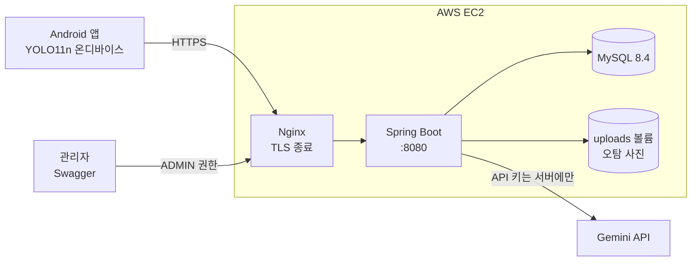
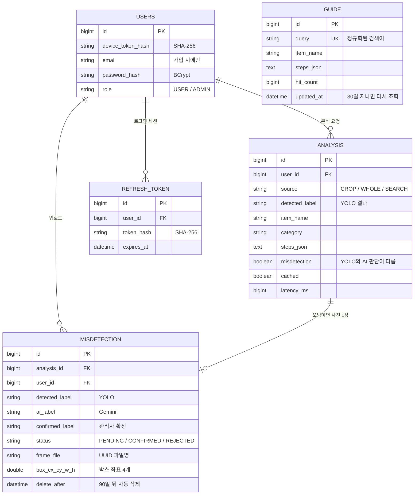
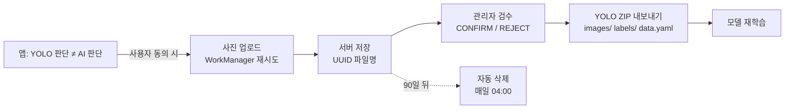

# 버림가이드 서버 (WasteSortingServer)

[](https://github.com/eovk01100-wq/WasteSortingServer/actions/workflows/ci.yml)

Android 앱 **[버림가이드](https://github.com/eovk01100-wq/WasteSortingApp)** 의 백엔드입니다.
앱에 있던 Gemini 호출을 서버로 옮겨 **API 키를 휴대폰에서 없애고**, 분석 기록·계정·검색 캐시를 관리하며,
온디바이스 YOLO가 틀린 사진을 모아 **사람이 검수한 뒤 재학습 데이터(YOLO 형식 ZIP)로 내보내는** 흐름을 담당합니다.

- 운영 주소: `https://buriimguide-jiwoo.duckdns.org`
- API 문서(Swagger): `https://buriimguide-jiwoo.duckdns.org/swagger-ui/index.html`

## 기술 스택

| 구분 | 사용 기술 |
|---|---|
| 언어·프레임워크 | Java 17, Spring Boot 4.1, Spring Security, Spring Data JPA (Hibernate 7) |
| DB | MySQL 8.4 (Docker), 테스트는 H2 + Testcontainers MySQL |
| 인증 | 기기 토큰 + JWT(JJWT, 15분) + 리프레시 토큰(14일, 회전), BCrypt |
| AI | Google Gemini API (`gemini-3.1-flash-lite`) |
| 문서 | springdoc-openapi (Swagger UI) |
| 배포 | Docker Compose, AWS EC2, Nginx 리버스 프록시, Let's Encrypt HTTPS |
| CI | GitHub Actions (push·PR마다 전체 테스트) |

## 아키텍처



요청 하나가 서버 안에서 지나가는 순서:

`RateLimitFilter`(IP·사용자별 횟수 제한) → `TokenAuthFilter`(기기 토큰 또는 JWT 확인) → Controller → Service → Gemini / DB

## 데이터 모델 (ERD)



## API

모든 경로는 `/api/v1` 아래에 있습니다. 🔓 = 토큰 없이 호출 가능, 🛡 = 관리자 전용.

| 메서드 | 경로 | 설명 |
|---|---|---|
| GET | `/health` 🔓 | 서버 상태 확인 |
| POST | `/auth/device` 🔓 | 기기 토큰 발급 (앱 첫 실행 시 자동) |
| POST | `/auth/signup` | 기기 사용자를 이메일 계정으로 전환 |
| POST | `/auth/login` 🔓 | 로그인 → JWT + 리프레시 토큰 |
| POST | `/auth/refresh` 🔓 | 리프레시 토큰 교체(회전) |
| POST | `/auth/logout` 🔓 | 리프레시 토큰 폐기 |
| POST | `/analyses` | 사진 + YOLO 결과로 분리배출 분석 (multipart, 2MB) |
| GET | `/search?q=` | 물건 이름으로 검색 (캐시 사용) |
| GET | `/analyses` | 내 분석 기록 (페이지) |
| GET | `/analyses/{id}` | 분석 상세 |
| POST | `/analyses/{id}/frame` | 오탐 사진 업로드 (사용자 동의 시에만) |
| DELETE | `/users/me` | 계정 삭제 (가입 계정은 비밀번호 확인) |
| GET | `/admin/misdetections` 🛡 | 검수 대기 목록 |
| GET | `/admin/misdetections/{id}/image?box=true` 🛡 | 사진 + 빨간 박스 |
| PATCH | `/admin/misdetections/{id}` 🛡 | 정답 확정(CONFIRM) / 반려(REJECT) |
| GET | `/admin/misdetections/export` 🛡 | 확정 데이터 YOLO 형식 ZIP |

에러는 항상 같은 JSON 모양으로 돌려줍니다: `{"code": "...", "message": "..."}`

## 설계에서 고민한 점

**1. API 키를 앱에서 없애기**
처음에는 앱이 Gemini를 직접 불러서 APK 안에 키가 들어 있었습니다. 서버가 대신 호출하게 바꾸고,
키는 서버의 `.env`에만 둡니다. 앱에는 서버 주소만 있습니다.

**2. 가입 없이 바로 쓰고, 원하면 계정으로 전환**
앱을 처음 켜면 기기 토큰(`dev_...`)을 받아 바로 사용합니다. 가입하면 같은 사용자 행에 이메일·비밀번호가 붙어서
그동안의 기록이 그대로 이어집니다. DB에는 토큰 원문이 아니라 SHA-256 해시만 저장합니다.

**3. 짧은 JWT + 회전하는 리프레시 토큰**
JWT는 15분, 리프레시 토큰은 14일이며 쓸 때마다 새것으로 바뀝니다. 계정을 삭제하면 아직 만료 전인 JWT도
필터에서 사용자 존재 여부를 확인해 바로 거절합니다.

**4. Gemini 호출 중에는 DB 트랜잭션을 잡지 않기**
AI 응답이 수 초~수십 초 걸리기 때문에 그동안 DB 연결을 붙잡지 않도록, 호출이 끝난 뒤 저장만 짧게 처리합니다.
재시도는 일시적 장애(500/503)에만 최대 3번 하고, 키 오류(401)나 한도 초과(429)는 바로 알려 줍니다.

**5. 오탐 데이터 수집 루프**



업로드는 기본값이 **꺼짐**이고, 사용자가 켜야만 보냅니다. 사진은 1280px·JPEG로 줄여서 보내며,
서버는 파일 앞부분(매직 바이트)으로 실제 이미지인지 확인합니다.

**6. 남용 막기**
AI를 부르는 요청(분석·검색)은 토큰당 1분 20회·IP당 1분 60회·서버 전체 하루 500회까지,
로그인·가입은 IP당 10분에 10회까지 허용합니다. 숫자는 `.env`에서 바꿀 수 있습니다.

## 측정한 숫자

| 항목 | 결과 |
|---|---|
| 검색 캐시 미스 (Gemini 호출, 혼잡 시간) | 약 27.7초 |
| 검색 캐시 적중 | 수십 ms |
| 자동 테스트 | 31개 (MockMvc 30 + Testcontainers 통합 1) |

응답의 `latencyMs`와 `cached` 값으로 매 요청의 소요 시간과 캐시 사용 여부를 확인할 수 있습니다.
같은 물건을 여러 사람이 검색하는 경우가 많아서, 검색어를 정규화한 뒤 30일 동안 결과를 재사용합니다.

## 테스트

```bash
./gradlew test
```

- **MockMvc + H2**: 인증, 권한(401/403), 분석, 오탐 업로드, 관리자 검수, 계정 삭제, 에러 응답 형식
- **Gemini는 Mock 처리**: 테스트가 실제 API 키나 요금 없이 돌아갑니다
- **Testcontainers MySQL**: 실제 MySQL 8.4에서 가입 → 분석 → 기록 조회 전체 흐름 확인 (Docker가 없으면 자동으로 건너뜀)
- **GitHub Actions**: push·PR마다 위 테스트 전체 실행

## 로컬에서 실행하기

필요한 것: Docker Desktop, JDK 17

```bash
git clone https://github.com/eovk01100-wq/WasteSortingServer.git
cd WasteSortingServer
cp .env.example .env      # .env를 열어 DB 비밀번호, GEMINI_API_KEY, JWT_SECRET(32자 이상) 입력
docker compose up -d --build
```

- 상태 확인: http://localhost:8080/api/v1/health
- Swagger: http://localhost:8080/swagger-ui/index.html

> `.env`를 고친 뒤에는 `docker compose up -d --force-recreate app` 으로 컨테이너를 다시 만들어야 새 값이 적용됩니다.

## 보안 메모

- 비밀값(`.env`, 서버 접속 키)은 Git에 올리지 않습니다. 형식은 `.env.example`만 공개합니다.
- DB(3307)와 앱(8080) 포트는 `127.0.0.1`에만 열고, 외부에서는 Nginx(443)로만 들어옵니다.
- 컨테이너는 root가 아닌 `spring` 사용자로 실행합니다.
- 토큰·비밀번호는 원문을 저장하지 않습니다 (SHA-256 / BCrypt).
